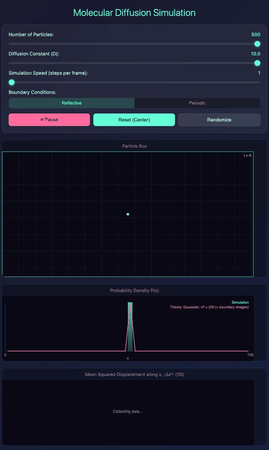

# Molecular Diffusion Simulator

An interactive browser demo of Brownian motion and diffusion, made for teaching systems biology.

**▶ [Run the demo](https://macdobry.net/teaching/diff-demo/diff_simulator.html)**

Particles perform a Gaussian random walk in a 2D box. Three linked panels compare the simulation with theory as it runs:

- **Particle box**: the particles themselves, starting from the centre or spread uniformly.
- **Probability density P(x)**: histogram of x positions, overlaid with the solution of the diffusion equation (a Gaussian of variance 2Dt, with mirror or periodic images at the walls).
- **Mean squared displacement ⟨Δx²⟩**: measured 1D MSD against free diffusion (2Dt) and, for reflective walls, the exact result for a closed box, which saturates once particles feel the walls.

Students can change the number of particles, the diffusion constant D (also mid-run), the simulation speed, and switch between reflective and periodic boundaries.

## Running locally

Open `index.html` in a browser. No server, build step or dependencies are needed.

## Building and assets

- `./build.sh` inlines `styles.css` and `app.js` into `index.html` and writes the single-file version `dist/diff_simulator.html` (the file that is hosted and can be shared by e-mail or uploaded to ILIAS/Moodle). Requires `python3`.
- `./make_gif.sh` regenerates `docs/diffusion.gif` from headless screenshots of the built page. Requires Google Chrome and `python3` with Pillow; takes about a minute.
